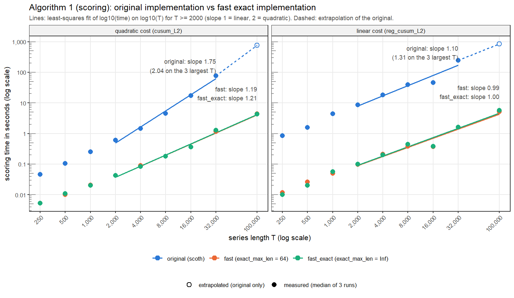
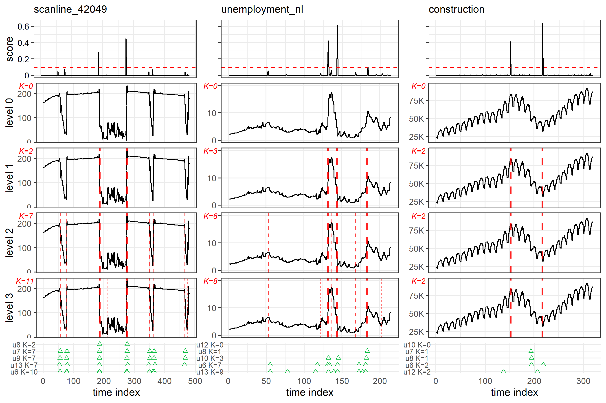

# DM_final
基於 Changepoint Detection via Subset Chains，PAKDD 2025 的修正
## 執行環境

- **R**：4.6.2（2026-10-29 ucrt）
- **平台**：Windows 64 位元（`x86_64-w64-mingw32`）

| R 套件 | 已安裝版本 |
| --- | --- |
| scoth | 1.0 |
| dplyr | 1.2.1 |
| ggplot2 | 4.0.3 |
| grid | 4.6.2 |
| gridExtra | 2.3.1 |
| here | 1.0.2 |
| jsonlite | 2.0.0 |
| logger | 0.4.3 |
| tibble | 3.3.1 |
| tidyr | 1.3.2 |
| testthat | 3.3.2 |
| pkgload | 1.5.3 |
| scoth.fast | 1.0.5 | 


## 操作步驟
* 事先在電腦中準備好環境，環境包含
    * R  4.6.2
    * git
    * Windows 11 和 Windows PowerShell 5.1
      

1. 下載專案

```
git clone https://github.com/ryugamine020401/DM_final.git
Set-Location DM_final
```

2. 確保當前的 PowerShell 可以找到 R
```
$R = Get-ChildItem "$env:LOCALAPPDATA\Programs\R", "$env:ProgramFiles\R" -Directory -ErrorAction SilentlyContinue | Where-Object { $_.Name -match '^R-\d+\.\d+\.\d+$' -and (Test-Path "$($_.FullName)\bin\Rscript.exe") } | Sort-Object { [version]$_.Name.Substring(2) } -Descending | Select-Object -First 1 -ExpandProperty FullName
if (-not $R) { "STOP: R was not found in the default install folders." } else { $R = "$R\bin"; $env:Path = "$R;" + $env:Path; $env:LANGUAGE = "en"; if ($R -like "$env:ProgramFiles*") { Rscript -e "dir.create(Sys.getenv('R_LIBS_USER'), recursive = TRUE, showWarnings = FALSE)" }; Rscript --version }
```
> 可以用 `Rscript --version` 確認 如果安裝好會出現
> Rscript (R) version 4.6.2 (2026-10-29)

3. 安裝 R 的套件
```
Rscript setup\install_packages.R
```
> All requested packages are installed. 表示完成

4. 取得 TCPD 資料
```
git clone https://github.com/ahstat/scoth-segmentation.git reference\scoth-segmentation
git -C reference\scoth-segmentation checkout 0eecacf1ae892b6cf9c2c3b45f965fe50c4fba5c
Copy-Item -Recurse reference\scoth-segmentation\public-data project0_reproduction\
Copy-Item -Recurse reference\scoth-segmentation\public-data project5_fast_scoring\
```
> 從作者的 REPO 拿


5. 安裝原作者的套件 `scoth`
```
R.exe CMD INSTALL --no-multiarch project0_reproduction
```
> `* DONE (scoth)`

6. 單元測試
```
Set-Location project0_reproduction
Rscript experiments\run_tests.R
```
> tests: 21 expectations: 155 failed: 0 errors: 0

7. 重現作者的原始論文(約 10~18 分鐘)
```
New-Item -ItemType Directory -Force logs | Out-Null
cmd.exe /c "Rscript experiments\main.R > logs\main_run.log 2>&1"
```
> 可用以下兩條指令確認是否重現(對於 Table2)
> `Get-Content -Encoding UTF8 output-data\table_left.txt`
> `Get-Content -Encoding UTF8 output-data\table_right.txt`
>  0.87、0.92、0.82、0.76，對應論文 Table 2 的 Ours 列


8. 重現改善後的方法(約 1 小時上下)
```
Set-Location ..\project5_fast_scoring
$env:SCOTH_MAX_SECONDS_ORIGINAL = "600"
powershell -ExecutionPolicy Bypass -File .\run_all.ps1
Remove-Item Env:SCOTH_MAX_SECONDS_ORIGINAL
```
> 完成後會顯示 `ALL STEPS FINISHED`
> 共分八個階段
> 1. 安裝 scoth.fast
> 2. 30 個單元測試
> 3. 實驗 A：計分時間對序列長度
> 4. 實驗 B：隨機序列的正確性
> 5. TCPD 上的正確性
> 6. 用快速版跑完整個 TCPD 流程
> 7. 三種評估協定
> 8. 和 project0 逐項比較

在規格為 
CPU : i5-13420H 
RAM : DDR4 32GB
的情況下，每個階段各花的時間

| 階段 | 時間 | 
| -------- | -------- | 
| 階段一     |      | 
| 階段二     |  62 秒    | 
| 階段三     |  2136 秒    | 
| 階段四     |  663 秒    | 
| 階段五     |  152 秒    | 
| 階段六     |  1033 秒    | 
| 階段七     |  4 秒    | 
| 階段八     |  11 秒    | 

## 資料集來源
TCPD 出自 van den Burg 和 Williams 的 An Evaluation of Change Point Detection Algorithms，arXiv:2003.06222，2020

實作中會從原作者 repo 的 public-data/ 取得

# 專案目錄
```
DM_final/
├── demo/
│   └── demo_live.R                # Demo
├── setup/
│   └── install_packages.R         # 安裝 R 套件
├── project0_reproduction/         # 原論文重現基準
└── project5_fast_scoring/         # 快速計分與分割改良
    ├── R/                         # 快速演算法、新舊切換與評估程式
    ├── experiments/               # 重現、正確性與效能比較實驗
    ├── tests/                     # 原版及改良版單元測試
    ├── man/                       # R 函式說明文件
    ├── results/                   # 比較結果 CSV、圖表與案例說明
    ├── DESCRIPTION                # scoth.fast 套件資訊與依賴
    ├── NAMESPACE                  # 對外提供的函式
    ├── scoth.Rproj                # RStudio 專案設定
    ├── run_all.ps1                # 一次執行安裝、測試與實驗
    └── README_original_authors.md # 原作者說明
 
```


# 改良結果展示


